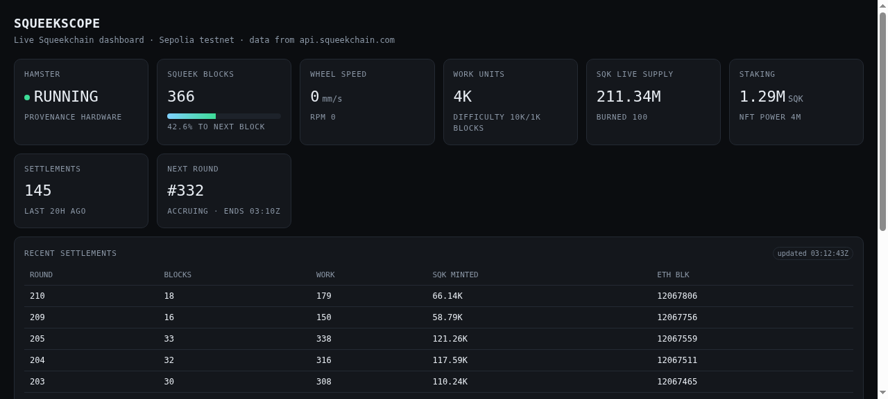

# SqueekScope

A live, read-only dashboard for [Squeekchain](https://squeekchain.com) — the
hamster-powered proof-of-work toychain on Ethereum Sepolia.

Built against the project's public read API
(`https://api.squeekchain.com/v1/...`, no API key required) and documented in
[docs.squeekchain.com/developers/api](https://docs.squeekchain.com/developers/api/).



**Live demo:** https://0xhrtzzc.github.io/squeekscope/

## What it shows

| Panel | Source | Meaning |
|---|---|---|
| Hamster | `/v1/status` → `measurement` | live/offline, provenance, wheel speed (mm/s), rpm |
| Squeek blocks | `/v1/core` → `core` | block height, progress to next block, cumulative work, difficulty |
| SQK supply | `/v1/economy/state` → `supply` | live supply, total burned |
| Staking | `/v1/economy/state` → `staking` | total staked SQK, total NFT power |
| Settlements | `/v1/settlements` | settlement count, last settle time, next round |
| Recent settlements | `/v1/settlements` → `recentSettlements` | per-round blocks, work added, SQK minted |
| Event feed | `/v1/events` | live chain/nft/staking/system events |

Units follow the API convention: `…BaseUnits` are 18-decimal $SQK, `blockHeight`
and similar are **Squeek blocks** (1,000,000,000 block units each), not Ethereum
blocks. Large integers arrive as decimal strings and are parsed as numbers here
(the values stay far below 2^53).

## Deploy shapes

`index.html` is a self-contained static page that calls
`https://api.squeekchain.com/v1/...` directly — the API sends
`access-control-allow-origin: *`, so a browser can read it from any origin.

`server.py` is an **optional** local runner for when you want one origin with no
third-party requests: it serves the page and re-exposes the API under
`/api/<path>` (allow-listed, 3s memo). Same page, no changes needed.

One caveat worth knowing: Cloudflare in front of the API rejects an obvious
`HeadlessChrome` User-Agent. A normal browser is fine; automated checks need to
send a desktop UA.

## Run

```bash
python3 server.py 8842     # http://localhost:8842
```

Endpoints:

- `GET /` — dashboard
- `GET /api/status` · `/api/core` · `/api/economy/state` · `/api/settlements`
  · `/api/events` · `/api/measurement/blocks` · `/api/measurement/runs`
- `GET /healthz` — liveness

## Notes

- Read-only: no wallet, no keys, no transactions. Nothing to sign.
- `"status": "unavailable"` with HTTP 200 means *unknown*, not zero — the
  dashboard shows the last good value rather than inventing one.
- The Sepolia deployment is `core-sepolia-20261103`, revision 7, chain
  `11155111`; contract IDs come from
  [the deployment record](https://docs.squeekchain.com/developers/#deployments),
  never from an API response.
